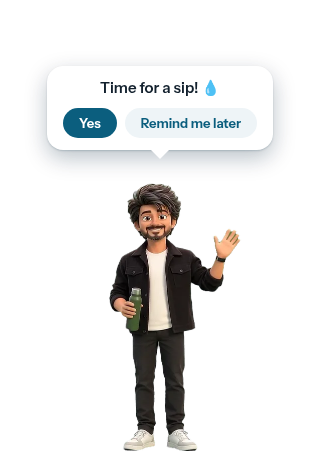
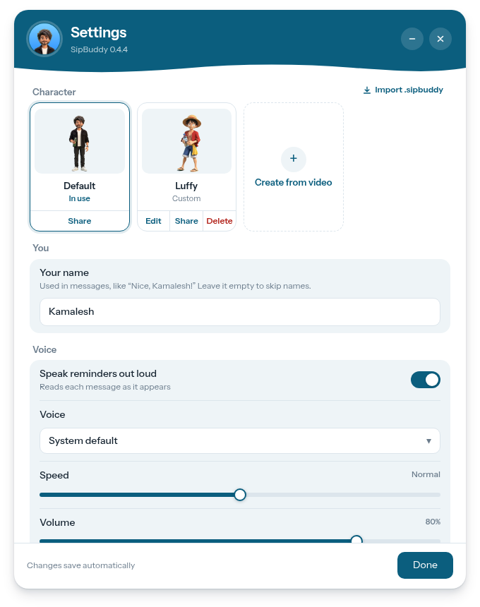
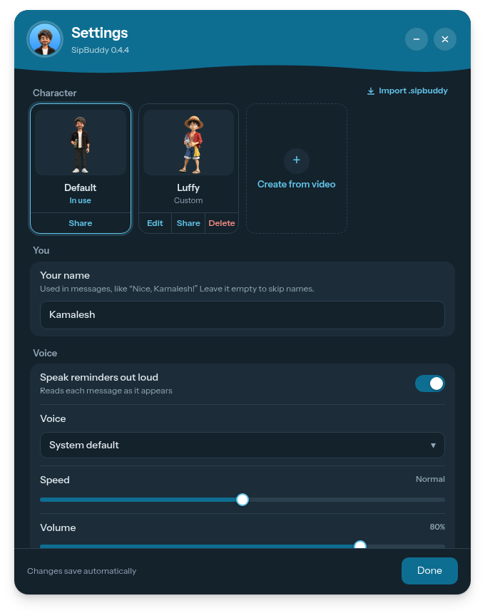

# SipBuddy

A little character that walks onto your desktop and asks whether you've had
some water. Answer **Yes** and they cheer; pick **Remind me later** and they'll
be back. Make your own buddy from a short video of any character.

  
  &nbsp;&nbsp;
  
  &nbsp;
  

## Download

**[Download the latest version](https://github.com/KamaleshKannaL/sipbuddy/releases/latest)**: free, for Windows and Linux.

| Your computer | File to download |
|---|---|
| **Windows 10 / 11** | `SipBuddy-…-windows-setup.exe`: double-click to install. No admin rights needed. |
| Windows, without installing | `SipBuddy-…-windows-portable.zip`: unzip, then run `SipBuddy.exe` |
| **Linux** (64-bit) | `SipBuddy-…-linux-x86_64.AppImage`: right-click → Properties → allow running as a program (or `chmod +x`), then open it |

On Linux, SipBuddy needs WebKitGTK 4.1 (already on Ubuntu 22.04+, Fedora 37+
and most current desktops). For spoken reminders, install `speech-dispatcher`.

## What it does

- **A buddy, not a notification.** They walk in from the edge of the screen,
  talk (out loud if you like), and walk off again.
- **Make your own.** Upload an 8–10 second video of a character on a green
  screen, and SipBuddy removes the background and cuts it into walk-in, ask,
  cheer and walk-out. Edit it later, or share it as a `.sipbuddy` file.
- **Private.** No account, no internet connection, no tracking. Everything
  stays on your computer ([details](SECURITY.md)).
- **Light and dark mode**, following your system.

## Make your own character

In Settings, choose **Create from video**. The wizard shows a prompt you can
paste into AI video tools; the video should be:

- 16:9, 8–10 seconds, on a solid green background (blue if the character
  wears green), with a locked camera;
- in this order: walk in, wave or ask, cheer, walk out.

## Problems or ideas

Open an [issue](https://github.com/KamaleshKannaL/sipbuddy/issues).

---

SipBuddy is free to use. © 2026 Kamalesh Kanna, all rights reserved; see
[LICENSE](LICENSE). Includes FFmpeg (LGPL) and other components listed in
[THIRD_PARTY_NOTICES.md](THIRD_PARTY_NOTICES.md).
